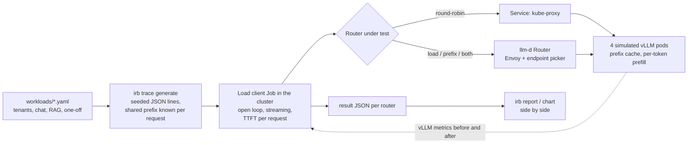

# k8s-inference-routing-benchmark

[](https://github.com/sunilmehta-si/k8s-inference-routing-benchmark/actions/workflows/ci.yml) [](https://github.com/sunilmehta-si/k8s-inference-routing-benchmark/actions/workflows/cluster.yml)

**How much does the router in front of your LLM servers matter?** This project answers that with numbers. It replays
the same chat and RAG traffic through four ways of spreading requests over vLLM pods on Kubernetes and measures what
users feel (time to first token), what the cluster does (prefix-cache hits, load spread, throughput) and whether
requests meet a latency objective. **No GPUs are needed**: the model servers are the
[llm-d vLLM simulator](https://github.com/llm-d/llm-d-inference-sim), which models prefill, decode, load and a real
prefix cache over real token blocks.

| Router | What it looks at |
|---|---|
| `round-robin` | Nothing: a Kubernetes Service, which kube-proxy spreads over the pods per connection. |
| `load-aware` | Each pod's queued and running work, from the pods' own vLLM metrics. |
| `prefix-aware` | Which pod most likely holds the longest prefix of this prompt in its cache. |
| `prefix-load-aware` | Both, weighted equally. |

The last three are the [llm-d Router](https://github.com/llm-d/llm-d-router) v1.0.0 (Envoy plus the endpoint picker
that implements the [Gateway API Inference Extension](https://github.com/kubernetes-sigs/gateway-api-inference-extension)'s
`InferencePool`) with one scoring configuration changed between them. Everything else, the trace, the model servers,
their latency profile and cache, is identical, and every router starts on its own cluster with empty caches.

## Why prefix caching decides this

A vLLM server keeps the attention state (KV cache) of prompts it has processed. When a new prompt starts with text
the server has already seen, it skips recomputing that part, and the first token arrives sooner. Real traffic repeats
itself: every chat turn resends the system prompt and the whole conversation, and every question about a document
resends the document. In the [workload](workloads/chat-rag-mix.yaml) here, **86% of all prompt text was sent before**.

On the simulated 8B-class model on an H100 (the simulator's own reference profile), a 2,000-token prompt costs about
530 ms of prefill when nothing is cached and about 35 ms when its prefix is. Whether a request finds its prefix
depends entirely on which pod the router sends it to.

## Results

The same 1,672-request trace ([chat-rag-mix](workloads/chat-rag-mix.yaml), replayed at 2x, about 11 requests a
second) through each router on its own kind cluster with four simulated vLLM pods, in
[CI](https://github.com/sunilmehta-si/k8s-inference-routing-benchmark/actions/runs/40304028854). Every request
answered; the load client never fell behind. [Full results](results/chat-rag-mix/README.md).


| Router | TTFT p50 | TTFT p95 | TTFT p99 | Prefix-cache hits | Load balance | Goodput (TTFT < 1 s) |
|---|---|---|---|---|---|---|
| round-robin (Service) | 132 ms | 717 ms | 967 ms | 64.3% | 0.97 | 99.1% |
| load-aware | 123 ms | 684 ms | **857 ms** | 64.4% | 0.95 | **99.8%** |
| prefix-aware | 89 ms | 718 ms | 1,315 ms | 80.0% | 0.66 | 98.1% |
| prefix-load-aware | **81 ms** | **630 ms** | 1,048 ms | **82.3%** | 0.70 | 98.9% |

What the numbers say:

- **Knowing the prompt is what moves the median.** Prefix-aware routing lifts the pods' cache hit rate from 64% to
  80-82%, close to the 86% the trace allows, and the median user waits 38% less for the first token (132 to 81 ms).
  Load-awareness alone leaves the hit rate where round-robin had it.
- **Prefix affinity alone piles work onto a few pods.** With only the prefix scorer, two pods served 638 and 631
  requests while one served 87; that idle pod's cache barely warmed (1.7% hits). The tail paid for it: p99 TTFT
  rose 36% over round-robin, and goodput was the lowest of the four.
- **Adding load to the same decision recovers most of it.** Prefix plus load gave the best median, the best p95
  (12% under round-robin) and the best throughput, and halved chat's p95 (334 to 195 ms), whose growing
  conversations gain the most from a warm pod. Its p99 is still 8% above round-robin and its balance 0.70: a router
  that chases cache hits trades some evenness for them.
- **Traffic with nothing to share pays a little.** One-off prompts can't be accelerated by any router, and under
  prefix-only routing their p95 rose 14%; with load in the mix it was back to round-robin's.
- **Every request is accounted for.** The pods' cache counters and the cached-token figures the servers returned
  with each response add up to the same hit rate for every router, and the pods served exactly the 1,672 requests
  sent: nothing went uncounted or unscraped.

One run of one trace on a shared 4-CPU CI runner: treat the latency tails as indicative and the pods' counters as
exact. The [cluster workflow](.github/workflows/cluster.yml) reruns all four every week and on every push.

## How it works



- **Traces are exact about repetition.** The generator builds every prompt from segments (system prompt, document,
  messages) and records, per request, how many leading words an earlier request already sent: the most a perfect
  prefix cache could skip. Same spec and seed, same trace, byte for byte.
- **The client is open loop.** Each request is sent at its arrival time whether or not earlier ones have answered,
  the way users arrive; a client that waits for answers would hide the queueing a bad router causes. It records how
  late it started each request and marks a run where it fell behind, so its own delay is never passed off as the
  router's.
- **The servers report what happened.** The run reads every pod's `vllm:prefix_cache_hits_total`,
  `prefix_cache_queries_total` and `request_success_total` before and after, so the hit rate and load spread are the
  pods' own counts, not an inference from latency.
- **Comparisons refuse to be unfair.** Results name their trace by sha256 and their model servers by image and
  configuration; `irb report` will not put side by side results that replayed different traffic or servers.
- **The router fails closed.** The chart's default lets traffic bypass an unreachable endpoint picker; here a
  broken picker fails requests instead of silently measuring no routing at all.

More in [docs/methodology.md](docs/methodology.md).

## Quick start

```bash
pip install -e .
irb trace generate workloads/chat-rag-mix.yaml -o runs/chat-rag-mix.jsonl
irb trace stats runs/chat-rag-mix.jsonl
```

Against any OpenAI-compatible endpoint (a vLLM server, a gateway, the simulator):

```bash
irb run --url http://localhost:8000 --model Qwen/Qwen2.5-1.5B-Instruct --trace runs/chat-rag-mix.jsonl \
  --mode my-router --scrape pod-0=http://localhost:8000/metrics -o runs/my-router.json
irb report runs/*.json
```

On a local kind cluster (Docker, kind, kubectl and Helm; the scripts only ever act on the `kind-irb` context):

```bash
make cluster MODE=prefix-load-aware
```

## Status

| Part | State |
|---|---|
| Workload specs, seeded traces with exact shared-prefix accounting | Done, tested |
| Open-loop streaming load client, run summaries, pod counters, reports, charts | Done, tested |
| Four routers on kind with simulated vLLM pods, in CI on every push; committed results | Done, results reproduced into the report by the tests |
| Precise prefix-cache scoring (the endpoint picker reading the pods' KV-cache events) | Next |
| Prefill/decode disaggregation, more replicas and traffic shapes | Planned |

## Related projects

- [k8s-gpu-scheduler-benchmark](https://github.com/sunilmehta-si/k8s-gpu-scheduler-benchmark): the same approach for
  GPU schedulers (default, Kueue, Volcano, KAI), on real schedulers in CI with simulated GPU nodes.
- [kubernetes-secure-mlops-pipeline](https://github.com/sunilmehta-si/kubernetes-secure-mlops-pipeline): signed,
  evaluated and admission-controlled model delivery on KServe.
- [jev-inference-router](https://github.com/sunilmehta-si/jev-inference-router) routes by meaning (which handler
  should answer a question) and [llm-inference-platform](https://github.com/sunilmehta-si/llm-inference-platform)
  serves one engine behind a gateway. This project is the layer between them at scale: many copies of the same
  model, and which one each request should go to.

## License

MIT
