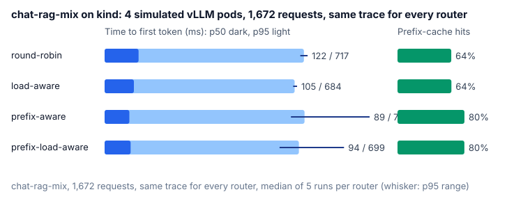
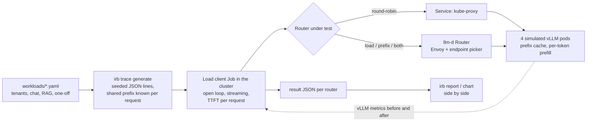

# k8s-inference-routing-benchmark

[](https://github.com/sunilmehta-si/k8s-inference-routing-benchmark/actions/workflows/ci.yml) [](https://github.com/sunilmehta-si/k8s-inference-routing-benchmark/actions/workflows/cluster.yml)

**How much does the router in front of your LLM servers matter?** This project answers that with numbers. It replays
the same chat and RAG traffic through four ways of spreading requests over vLLM pods on Kubernetes and measures what
users feel (time to first token), what the cluster does (prefix-cache hits, load spread, throughput) and whether
requests meet a latency objective. **No GPUs are needed**: the model servers are the
[llm-d vLLM simulator](https://github.com/llm-d/llm-d-inference-sim), which models prefill, decode, load and a real
prefix cache over real token blocks.

| Router | What it looks at |
|---|---|
| `round-robin` | Nothing: a Kubernetes Service, which kube-proxy spreads over the pods per connection. |
| `load-aware` | Each pod's queued and running work, from the pods' own vLLM metrics. |
| `prefix-aware` | Which pod most likely holds the longest prefix of this prompt in its cache. |
| `prefix-load-aware` | Both, weighted equally. |
| `prefix-load-2x` | Both, with load weighted twice the prefix. |
| `prefix-load-q8` | Both, weighted equally, with the load scorer's queue threshold at the pods' concurrency (8). |

The last five are the [llm-d Router](https://github.com/llm-d/llm-d-router) v1.0.0 (Envoy plus the endpoint picker
that implements the [Gateway API Inference Extension](https://github.com/kubernetes-sigs/gateway-api-inference-extension)'s
`InferencePool`) with one scoring configuration changed between them. Everything else, the trace, the model servers,
their latency profile and cache, is identical, and every router starts on its own cluster with empty caches.

## Why prefix caching decides this

A vLLM server keeps the attention state (KV cache) of prompts it has processed. When a new prompt starts with text
the server has already seen, it skips recomputing that part, and the first token arrives sooner. Real traffic repeats
itself: every chat turn resends the system prompt and the whole conversation, and every question about a document
resends the document. In the [workload](workloads/chat-rag-mix.yaml) here, **86% of all prompt text was sent before**.

On the simulated 8B-class model on an H100 (the simulator's own reference profile), a 2,000-token prompt costs about
530 ms of prefill when nothing is cached and about 35 ms when its prefix is. Whether a request finds its prefix
depends entirely on which pod the router sends it to.

## Results

The same 1,672-request trace ([chat-rag-mix](workloads/chat-rag-mix.yaml), replayed at 2x, about 11 requests a
second) through each router eight times, every run on its own kind cluster with four fresh simulated vLLM pods, in
CI ([run 1](https://github.com/sunilmehta-si/k8s-inference-routing-benchmark/actions/runs/40304028854), [run 2](https://github.com/sunilmehta-si/k8s-inference-routing-benchmark/actions/runs/40305449205), [runs 3 to 5](https://github.com/sunilmehta-si/k8s-inference-routing-benchmark/actions/runs/40307507746),
[runs 6 to 8](https://github.com/sunilmehta-si/k8s-inference-routing-benchmark/actions/runs/40309989360)). All 53,504 requests were answered and the load client never fell behind.
[Full results](results/chat-rag-mix/README.md).



Each cell is the median of the eight runs, with the lowest and highest in brackets.

| Router | TTFT p50 | TTFT p95 | TTFT p99 | Prefix-cache hits | Load balance | Goodput (TTFT < 1 s) |
|---|---|---|---|---|---|---|
| round-robin (Service) | 121 ms (116–140) | 717 ms (673–731) | 952 ms (850–1,179) | 63.9% (63.3–64.6) | 0.96 (0.93–0.97) | 99.2% (98.6–99.5) |
| load-aware | 109 ms (99–126) | 683 ms (642–693) | 863 ms (825–897) | 64.3% (63.3–65.0) | 0.97 (0.92–0.99) | 99.5% (99.3–99.8) |
| prefix-aware | 88 ms (84–95) | 752 ms (614–954) | 1,255 ms (991–1,475) | 79.9% (78.9–82.4) | 0.60 (0.53–0.68) | 98.0% (95.8–99.0) |
| prefix-load-aware | 92 ms (81–122) | 718 ms (630–862) | 1,102 ms (982–1,601) | 79.8% (78.9–82.3) | 0.56 (0.50–0.70) | 98.6% (97.0–99.1) |

What held in all eight runs:

- **Prefix-aware routing finds the cache.** Both routers that score prefixes lifted the pods' hit rate from about
  64% to about 80% in every run, against the 86% the trace allows. Load-awareness alone left it where round-robin
  had it.
- **That cuts the median wait.** Prefix-only routing had a lower median TTFT than round-robin in every run: 88
  against 121 ms, 27% less. Prefix plus load was lower in every run too, though in one by under a millisecond; by
  24% at the median.
- **It also piles work onto two pods.** In every run of both prefix routers, two of the four pods served 69% to 90%
  of the requests and one served fewer than 160; load balance fell from about 0.96 to about 0.6. Under round-robin
  and load-aware routing no pod served more than 28%.
- **The tail pays for it, and load-aware routing has the best one.** Load-aware routing had a lower p99 and a higher
  goodput than both prefix routers in every run; prefix-only routing's median p99 was 45% above it. Load-aware also
  beat round-robin's p95 in every run, if only by 5%.
- **Traffic with nothing to share pays for prefix affinity.** One-off prompts can't be accelerated by any router.
  Under prefix-only routing their p95 was higher than under load-aware or prefix-plus-load routing in every run,
  and above round-robin's in seven runs of eight, by 29% at the median.
- **Every request is accounted for.** The pods' cache counters and the cached-token figures the servers returned
  with each response add up to the same hit rate in every run, and the pods served exactly the 1,672 requests sent.

What did not hold:

- **Adding load at equal weight did not reliably fix the pile-up.** The router's sample configuration weighs the two
  scorers equally. Against prefix-only routing it lowered p99 and raised goodput in five runs of eight, and spread
  the load no better (0.56 against 0.60): in three runs it sent at least 87% of requests to two pods. Its tail was
  behind load-aware's in every run.
- **The first run's headline was one run.** Run 1 showed prefix plus load with the best median and p95 and chat's
  p95 down 42%. Across eight runs its median ranged from 81 to 122 ms and chat's p95 from 195 to 661 ms, so neither
  claim stands. That is why every router now runs several times.

### Does weighting load higher fix the pile-up?

No. `prefix-load-2x` keeps both scorers and doubles the load scorer's weight. All five routers ran eight more times
in [one CI run](https://github.com/sunilmehta-si/k8s-inference-routing-benchmark/actions/runs/40460496902), on 40 fresh clusters that all started within six minutes. [Full results](results/load-weight/README.md).
Medians of those eight runs:

| Router | TTFT p50 | TTFT p99 | Prefix-cache hits | Load balance | Goodput |
|---|---|---|---|---|---|
| round-robin | 117 ms | 924 ms | 64.1% | 0.97 | 99.4% |
| load-aware | 113 ms | 854 ms | 64.1% | 0.96 | 99.5% |
| prefix-aware | 92 ms | 1,226 ms | 80.0% | 0.57 | 97.8% |
| prefix-load-aware | 93 ms | 1,163 ms | 79.7% | 0.55 | 98.1% |
| prefix-load-2x | 91 ms | 1,095 ms | 80.6% | 0.57 | 98.5% |

- **It keeps what prefix scoring buys.** Its hit rate and median TTFT beat round-robin's and load-aware's in every
  run, like the other two prefix routers.
- **It piles work up just the same.** Its load balance was no better than either prefix router's, and round-robin
  and load-aware beat its p99, goodput and balance in every run.
- **Against equal weights, nothing held.** No metric was better for one of the two weightings in all eight runs.

The scorer explains why. At the pinned commit the [load-aware scorer](https://github.com/llm-d/llm-d-router/blob/b9393d1a9f1d5a72ecd86f8d2b643ab54c2a9b92/pkg/epp/framework/plugins/scheduling/scorer/loadaware/load_aware.go#L93-L112) gives a pod with an empty queue 0.5 and
subtracts in proportion to waiting requests over a threshold of 128, so `0.5 × (1 − waiting / 128)`. It does not
count running requests. With up to eight requests running per pod, queues stay a few requests long, so the load score
differs between pods by about 0.02, while the prefix score spans 0 to 1. Doubling a difference that small changes
nothing. The next configuration to measure is a threshold near the pods' concurrency, not a larger weight.

Claims above are directions that held in every run unless they say otherwise;
[the methodology](docs/methodology.md#repeats) says how runs are repeated and judged. The
[cluster workflow](.github/workflows/cluster.yml) reruns every router three times each week and on every code change.

## How it works



- **Traces are exact about repetition.** The generator builds every prompt from segments (system prompt, document,
  messages) and records, per request, how many leading words an earlier request already sent: the most a perfect
  prefix cache could skip. Same spec and seed, same trace, byte for byte.
- **The client is open loop.** Each request is sent at its arrival time whether or not earlier ones have answered,
  the way users arrive; a client that waits for answers would hide the queueing a bad router causes. It records how
  late it started each request and marks a run where it fell behind, so its own delay is never passed off as the
  router's.
- **The servers report what happened.** The run reads every pod's `vllm:prefix_cache_hits_total`,
  `prefix_cache_queries_total` and `request_success_total` before and after, so the hit rate and load spread are the
  pods' own counts, not an inference from latency.
- **Comparisons refuse to be unfair.** Results name their trace by sha256 and their model servers by image and
  configuration; `irb report` will not put side by side results that replayed different traffic or servers.
- **The router fails closed.** The chart's default lets traffic bypass an unreachable endpoint picker; here a
  broken picker fails requests instead of silently measuring no routing at all.

More in [docs/methodology.md](docs/methodology.md).

## Quick start

```bash
pip install -e .
irb trace generate workloads/chat-rag-mix.yaml -o runs/chat-rag-mix.jsonl
irb trace stats runs/chat-rag-mix.jsonl
```

Against any OpenAI-compatible endpoint (a vLLM server, a gateway, the simulator):

```bash
irb run --url http://localhost:8000 --model Qwen/Qwen2.5-1.5B-Instruct --trace runs/chat-rag-mix.jsonl \
  --mode my-router --scrape pod-0=http://localhost:8000/metrics -o runs/my-router.json
irb report runs/*.json
```

On a local kind cluster (Docker, kind, kubectl and Helm; the scripts only ever act on the `kind-irb` context):

```bash
make cluster MODE=prefix-load-aware
```

## Status

| Part | State |
|---|---|
| Workload specs, seeded traces with exact shared-prefix accounting | Done, tested |
| Open-loop streaming load client, run summaries, pod counters, reports, charts | Done, tested |
| Four routers on kind with simulated vLLM pods, in CI on every push; committed results | Done, results reproduced into the report by the tests |
| Repeated runs, reported as median and range | Done: eight runs per router committed, three per CI run |
| A heavier load weight next to the prefix scorer | Done: no change, eight runs of every router |
| The load scorer's queue threshold near the pods' concurrency, and precise prefix-cache scoring (the endpoint picker reading the pods' KV-cache events) | Next |
| Prefill/decode disaggregation, more replicas and traffic shapes | Planned |

## Related projects

- [k8s-gpu-scheduler-benchmark](https://github.com/sunilmehta-si/k8s-gpu-scheduler-benchmark): the same approach for
  GPU schedulers (default, Kueue, Volcano, KAI), on real schedulers in CI with simulated GPU nodes.
- [kubernetes-secure-mlops-pipeline](https://github.com/sunilmehta-si/kubernetes-secure-mlops-pipeline): signed,
  evaluated and admission-controlled model delivery on KServe.
- [jev-inference-router](https://github.com/sunilmehta-si/jev-inference-router) routes by meaning (which handler
  should answer a question) and [llm-inference-platform](https://github.com/sunilmehta-si/llm-inference-platform)
  serves one engine behind a gateway. This project is the layer between them at scale: many copies of the same
  model, and which one each request should go to.

## License

MIT
