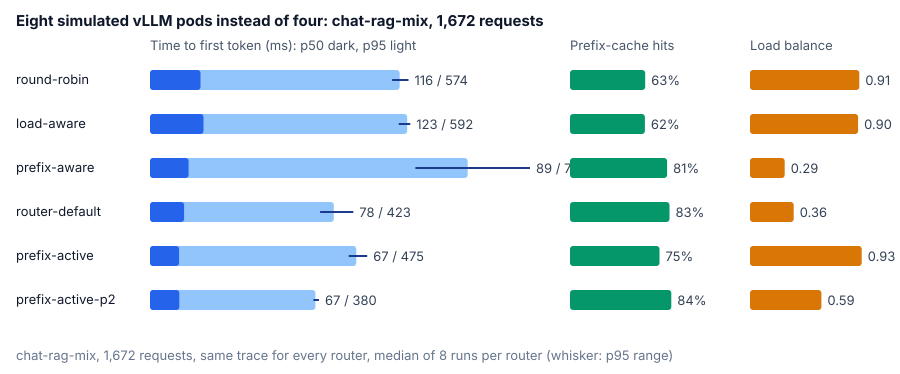
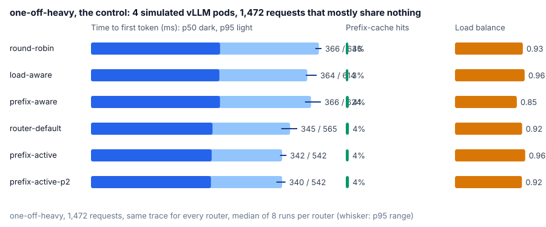
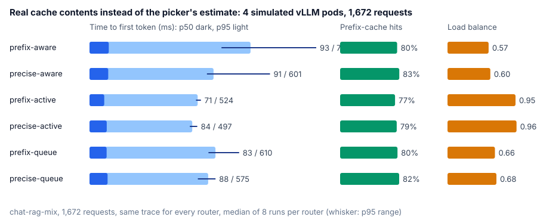
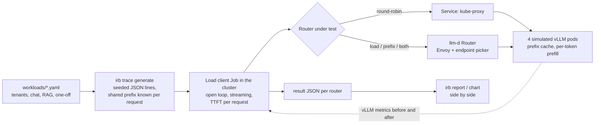

# k8s-inference-routing-benchmark

[](https://github.com/sunilmehta-si/k8s-inference-routing-benchmark/actions/workflows/ci.yml) [](https://github.com/sunilmehta-si/k8s-inference-routing-benchmark/actions/workflows/cluster.yml)

**How much does the router in front of your LLM servers matter?** This project answers that with numbers. It replays
the same chat and RAG traffic through twelve ways of spreading requests over vLLM pods on Kubernetes and measures what
users feel (time to first token), what the cluster does (prefix-cache hits, load spread, throughput) and whether
requests meet a latency objective. **No GPUs are needed**: the model servers are the
[llm-d vLLM simulator](https://github.com/llm-d/llm-d-inference-sim), which models prefill, decode, load and a real
prefix cache over real token blocks.

| Router | What it looks at |
|---|---|
| `round-robin` | Nothing: a Kubernetes Service, which kube-proxy spreads over the pods per connection. |
| `load-aware` | Each pod's waiting queue, from the pods' own vLLM metrics: 0.5 when empty, falling to 0 at 128 waiting. |
| `prefix-aware` | Which pod most likely holds the longest prefix of this prompt in its cache. |
| `prefix-load-aware` | Both, weighted equally. |
| `prefix-load-2x` | Both, with load weighted twice the prefix. |
| `prefix-load-q8` | Both, weighted equally, with the load scorer's queue threshold at the pods' concurrency (8). |
| `prefix-queue` | The prefix and the waiting queue, weighted equally, the queue rescaled across the pods (shortest 1, longest 0). |
| `prefix-running` | The prefix and the requests each pod is running, weighted equally, rescaled the same way. |
| `prefix-active` | The prefix and the requests the router itself has in flight to each pod, weighted equally. |
| `router-default` | The router chart's own default: waiting queue 2, KV-cache utilization 2, prefix 3. |
| `prefix-active-p2` | `prefix-active` with the prefix weighted 2. |
| `prefix-active-a2` | `prefix-active` with the in-flight count weighted 2. |

The last eleven are the [llm-d Router](https://github.com/llm-d/llm-d-router) v1.0.0 (Envoy plus the endpoint picker
that implements the [Gateway API Inference Extension](https://github.com/kubernetes-sigs/gateway-api-inference-extension)'s
`InferencePool`) with one scoring configuration changed between them. Everything else, the trace, the model servers,
their latency profile and cache, is identical, and every router starts on its own cluster with empty caches.

**The short answer so far.** Prefix-aware routing finds the cache (pod hit rate 64% to 80%) but piles the work onto
two of four pods, and the router's `load-aware` scorer did not undo that at any weight or threshold tried. Swapping it
for the router's `active-request-scorer` did: in eight runs `prefix-active` beat prefix-plus-load on median, p95 and
p99 time to first token and spread the work as evenly as load-aware routing, keeping 76% hits. With the prefix at
weight 2 it keeps 83%, level with the router chart's own default, with the best p95. On eight pods the prefix
routers' pile-up doubles while `prefix-active` stays even and still has the best median and tail.
[The scorer comparison](#do-the-routers-other-load-scorers-spread-the-work), [the weights](#what-does-each-weight-buy-prefix-active)
and [eight pods](#does-the-pile-up-grow-with-the-pool) have the numbers.

## The traces

| Trace | Requests | Rate | What repeats | Shared prefix |
|---|---|---|---|---|
| [`chat-rag-mix`](workloads/chat-rag-mix.yaml) | 1,672 | 5.6/s | system prompts, 40 documents, conversation history | 86% of prompt words |
| [`one-off-heavy`](workloads/one-off-heavy.yaml) | 1,472 | 4.9/s | one small assistant's chat turns; 94% one-off prompts | 3% |

Both are generated from a seed and pinned by fingerprint, so every run of every router replays the same requests.
`one-off-heavy` is the control: a router that scores prefixes has almost nothing to find in it, so it shows what
prefix scoring costs when it cannot help. The cluster workflow replays either at 2x (`SPEEDUP`).

## Why prefix caching decides this

A vLLM server keeps the attention state (KV cache) of prompts it has processed. When a new prompt starts with text
the server has already seen, it skips recomputing that part, and the first token arrives sooner. Real traffic repeats
itself: every chat turn resends the system prompt and the whole conversation, and every question about a document
resends the document. In the [workload](workloads/chat-rag-mix.yaml) here, **86% of all prompt text was sent before**.

On the simulated 8B-class model on an H100 (the simulator's own reference profile), a 2,000-token prompt costs about
530 ms of prefill when nothing is cached and about 35 ms when its prefix is. Whether a request finds its prefix
depends entirely on which pod the router sends it to.

## Results

The same 1,672-request trace ([chat-rag-mix](workloads/chat-rag-mix.yaml), replayed at 2x, about 11 requests a
second) through each router eight times, every run on its own kind cluster with four fresh simulated vLLM pods, in
CI ([run 1](https://github.com/sunilmehta-si/k8s-inference-routing-benchmark/actions/runs/40304028854), [run 2](https://github.com/sunilmehta-si/k8s-inference-routing-benchmark/actions/runs/40305449205), [runs 3 to 5](https://github.com/sunilmehta-si/k8s-inference-routing-benchmark/actions/runs/40307507746),
[runs 6 to 8](https://github.com/sunilmehta-si/k8s-inference-routing-benchmark/actions/runs/40309989360)). All 53,504 requests were answered and the load client never fell behind.
[Full results](results/chat-rag-mix/README.md).


Each cell is the median of the eight runs, with the lowest and highest in brackets.

| Router | TTFT p50 | TTFT p95 | TTFT p99 | Prefix-cache hits | Load balance | Goodput (TTFT < 1 s) |
|---|---|---|---|---|---|---|
| round-robin (Service) | 121 ms (116–140) | 717 ms (673–731) | 952 ms (850–1,179) | 63.9% (63.3–64.6) | 0.96 (0.93–0.97) | 99.2% (98.6–99.5) |
| load-aware | 109 ms (99–126) | 683 ms (642–693) | 863 ms (825–897) | 64.3% (63.3–65.0) | 0.97 (0.92–0.99) | 99.5% (99.3–99.8) |
| prefix-aware | 88 ms (84–95) | 752 ms (614–954) | 1,255 ms (991–1,475) | 79.9% (78.9–82.4) | 0.60 (0.53–0.68) | 98.0% (95.8–99.0) |
| prefix-load-aware | 92 ms (81–122) | 718 ms (630–862) | 1,102 ms (982–1,601) | 79.8% (78.9–82.3) | 0.56 (0.50–0.70) | 98.6% (97.0–99.1) |

What held in all eight runs:

- **Prefix-aware routing finds the cache.** Both routers that score prefixes lifted the pods' hit rate from about
  64% to about 80% in every run, against the 86% the trace allows. Load-awareness alone left it where round-robin
  had it.
- **That cuts the median wait.** Prefix-only routing had a lower median TTFT than round-robin in every run: 88
  against 121 ms, 27% less. Prefix plus load was lower in every run too, though in one by under a millisecond; by
  24% at the median.
- **It also piles work onto two pods.** In every run of both prefix routers, two of the four pods served 69% to 90%
  of the requests and one served fewer than 160; load balance fell from about 0.96 to about 0.6. Under round-robin
  and load-aware routing no pod served more than 28%.
- **The tail pays for it, and load-aware routing has the best one.** Load-aware routing had a lower p99 and a higher
  goodput than both prefix routers in every run; prefix-only routing's median p99 was 45% above it. Load-aware also
  beat round-robin's p95 in every run, if only by 5%.
- **Traffic with nothing to share pays for prefix affinity.** One-off prompts can't be accelerated by any router.
  Under prefix-only routing their p95 was higher than under load-aware or prefix-plus-load routing in every run,
  and above round-robin's in seven runs of eight, by 29% at the median.
- **Every request is accounted for.** The pods' cache counters and the cached-token figures the servers returned
  with each response add up to the same hit rate in every run, and the pods served exactly the 1,672 requests sent.

What did not hold:

- **Adding load at equal weight did not reliably fix the pile-up.** The router's sample configuration weighs the two
  scorers equally. Against prefix-only routing it lowered p99 and raised goodput in five runs of eight, and spread
  the load no better (0.56 against 0.60): in three runs it sent at least 87% of requests to two pods. Its tail was
  behind load-aware's in every run.
- **The first run's headline was one run.** Run 1 showed prefix plus load with the best median and p95 and chat's
  p95 down 42%. Across eight runs its median ranged from 81 to 122 ms and chat's p95 from 195 to 661 ms, so neither
  claim stands. That is why every router now runs several times.

### Does weighting load higher fix the pile-up?

No. `prefix-load-2x` keeps both scorers and doubles the load scorer's weight. All five routers ran eight more times
in [one CI run](https://github.com/sunilmehta-si/k8s-inference-routing-benchmark/actions/runs/40460496902), on 40 fresh clusters that all started within six minutes. [Full results](results/load-weight/README.md).
Medians of those eight runs:

| Router | TTFT p50 | TTFT p99 | Prefix-cache hits | Load balance | Goodput |
|---|---|---|---|---|---|
| round-robin | 117 ms | 924 ms | 64.1% | 0.97 | 99.4% |
| load-aware | 113 ms | 854 ms | 64.1% | 0.96 | 99.5% |
| prefix-aware | 92 ms | 1,226 ms | 80.0% | 0.57 | 97.8% |
| prefix-load-aware | 93 ms | 1,163 ms | 79.7% | 0.55 | 98.1% |
| prefix-load-2x | 91 ms | 1,095 ms | 80.6% | 0.57 | 98.5% |

- **It keeps what prefix scoring buys.** Its hit rate and median TTFT beat round-robin's and load-aware's in every
  run, like the other two prefix routers.
- **It piles work up just the same.** Its load balance was no better than either prefix router's, and round-robin
  and load-aware beat its p99, goodput and balance in every run.
- **Against equal weights, nothing held.** No metric was better for one of the two weightings in all eight runs.

The scorer explains why. At the pinned commit the [load-aware scorer](https://github.com/llm-d/llm-d-router/blob/b9393d1a9f1d5a72ecd86f8d2b643ab54c2a9b92/pkg/epp/framework/plugins/scheduling/scorer/loadaware/load_aware.go#L93-L112) gives a pod with an empty queue 0.5 and
subtracts in proportion to waiting requests over a threshold of 128, so `0.5 × (1 − waiting / 128)`. It does not
count running requests. With up to eight requests running per pod, queues stay a few requests long, so the load score
differs between pods by about 0.02, while the prefix score spans 0 to 1. Doubling a difference that small changes
nothing. The next configuration to measure is a threshold near the pods' concurrency, not a larger weight.

### Does a lower queue threshold let load count?

Not on its own. `prefix-load-q8` keeps equal weights and sets the load scorer's threshold to 8, the pods'
concurrency, so a few waiting requests move a pod's load score a lot. Load-aware, prefix-load-aware and q8 ran eight
times each in [one CI run](https://github.com/sunilmehta-si/k8s-inference-routing-benchmark/actions/runs/40464366888). [Full results](results/queue-threshold/README.md). Medians:

| Router | TTFT p50 | TTFT p99 | Prefix-cache hits | Load balance | Goodput |
|---|---|---|---|---|---|
| load-aware | 111 ms | 867 ms | 64.2% | 0.95 | 99.5% |
| prefix-load-aware | 94 ms | 1,232 ms | 80.0% | 0.55 | 98.1% |
| prefix-load-q8 | 94 ms | 1,132 ms | 79.6% | 0.56 | 98.4% |

- **The spread did not change.** q8's balance matched equal weights', load-aware beat its balance, p99 and goodput
  in every run, and no metric was better for one of the two prefix routers in all eight runs.
- **The scores' ranges say why.** The [prefix scorer](https://github.com/llm-d/llm-d-router/blob/b9393d1a9f1d5a72ecd86f8d2b643ab54c2a9b92/pkg/epp/framework/plugins/scheduling/scorer/prefix/plugin.go#L135-L175) gives each pod the share
  of the prompt's blocks it already holds, 0 to 1; a pod that holds a RAG document's whole prefix scores about 0.98.
  The [load scorer](https://github.com/llm-d/llm-d-router/blob/b9393d1a9f1d5a72ecd86f8d2b643ab54c2a9b92/pkg/epp/framework/plugins/scheduling/scorer/loadaware/load_aware.go#L93-L112) never gives more than 0.5, and 0 only when the queue
  reaches the threshold. At equal weights the most it can take away from a busy pod is 0.5, less than the prefix
  gap, so the pod holding the prefix wins however long its queue. Lowering the threshold lets load reach that 0.5
  sooner; it cannot make it larger.
- **What should work, then.** Load can outweigh a full prefix match only with its weight above about 2 and the
  threshold near the pods' concurrency, together, or with a load scorer whose scores span 0 to 1. The router has
  three of those; [what each scorer reads and how far apart it can put two pods](docs/scorers.md).

### Do the router's other load scorers spread the work?

Yes, the ones that rescale load across the pods. `prefix-queue`, `prefix-running` and `prefix-active` swap the load
scorer for one that gives the least loaded pod 1 and the most loaded 0; `router-default` is the chart's own scoring.
Each ran eight times beside load-aware and prefix-load-aware in
[one CI run](https://github.com/sunilmehta-si/k8s-inference-routing-benchmark/actions/runs/40650965766). [Full results](results/scorers/README.md). Medians:

| Router | TTFT p50 | TTFT p95 | TTFT p99 | Prefix-cache hits | Load balance | Goodput |
|---|---|---|---|---|---|---|
| load-aware | 110 ms | 685 ms | 874 ms | 64.2% | 0.95 | 99.5% |
| prefix-load-aware | 91 ms | 680 ms | 1,007 ms | 80.2% | 0.61 | 98.9% |
| router-default | 78 ms | 478 ms | 808 ms | 82.9% | 0.68 | 99.5% |
| prefix-queue | 84 ms | 612 ms | 902 ms | 80.7% | 0.66 | 99.2% |
| prefix-running | 80 ms | 595 ms | 754 ms | 69.5% | 0.98 | 99.6% |
| prefix-active | **74 ms** | 536 ms | **692 ms** | 76.4% | 0.95 | **99.7%** |

- **`prefix-active` was the best all-round router measured so far.** In every run it beat prefix-load-aware on
  median, p95 and p99 time to first token, goodput and balance, and beat load-aware on all of those latencies, goodput
  and cache hits while spreading the work as evenly. It paid about four points of hit rate against prefix-load-aware.
- **`prefix-running` spread the work most evenly** (0.98, better than every other prefix router in every run) and
  kept the fewest cache hits of them (70%): it ranks pods by running requests, so it outvotes a prefix match more
  often. `prefix-active`, which counts the requests the router itself has in flight rather than scraped metrics,
  beat it on p95, p99 and hit rate in every run.
- **The queue scorer changed the least.** Balance stayed near prefix-load-aware's (0.66) and below load-aware's in
  every run, as expected: queues only differ when some pod has requests waiting. It still had a lower median than
  prefix-load-aware in every run.
- **The chart's default kept the most cache hits** (83% median; more than every router but `prefix-queue` in every
  run) and had the best p95, beating prefix-load-aware on median, p95 and p99 in every run, but kept much of the
  pile-up (balance 0.68).
- **Why rescaling works where weight and threshold did not.** A rescaled scorer gives the busiest pod 0. When prefix
  routing piles requests onto a pod, that pod becomes the busiest, so it loses a full point exactly when the pile-up
  starts; `load-aware` can never take away more than 0.5. [The scorer reference](docs/scorers.md) has the formulas,
  and the predictions written before this run, two of which were wrong.

### What does each weight buy prefix-active?

`prefix-active-p2` weights the prefix twice the in-flight count, `prefix-active-a2` the other way round. Eight runs
of each beside `prefix-active` in
[one CI run](https://github.com/sunilmehta-si/k8s-inference-routing-benchmark/actions/runs/40837974457). [Full results](results/active-weights/README.md). Medians:

| Router | TTFT p50 | TTFT p95 | TTFT p99 | Prefix-cache hits | Load balance | Goodput |
|---|---|---|---|---|---|---|
| prefix-active | **71 ms** | 523 ms | 704 ms | 76.7% | 0.95 | **99.7%** |
| prefix-active-p2 | 75 ms | **461 ms** | **657 ms** | **83.4%** | 0.85 | 99.6% |
| prefix-active-a2 | 80 ms | 587 ms | 724 ms | 69.4% | **0.97** | 99.6% |

- **Weighting the prefix twice bought the most cache hits of any router measured here**, 83%, against the 86% the
  trace allows, and the best p95 and p99. It beat `prefix-active` on p95 and hits in every run, for chat and RAG
  traffic in every run, for one-off prompts in six of eight, and on p99 in seven of eight. The price was spread:
  balance 0.85, below `prefix-active`'s in every run, though well clear of the 0.6 the pile-up gave.
- **Weighting the in-flight count twice bought nothing.** It spread the work most evenly but lost hits (69%) and
  was slower than `prefix-active` at p50, p95 and p99 in every run: an evenly loaded pod that has to prefill a
  document costs more than a slightly busier one that has it cached.
- **The median moved the other way, and not reliably.** `prefix-active` had the lower median than p2 in seven runs
  of eight and the higher goodput in six; the heavier prefix shows up in the tail, where a request that misses its
  cache waits longest.

### The two best routers in the same run

The scorer and weight comparisons came from different CI runs, so "most cache hits of any router" compared across
runs. This run puts `prefix-active-p2` and `router-default` side by side, with prefix-only and round-robin for
scale, eight times each
([run](https://github.com/sunilmehta-si/k8s-inference-routing-benchmark/actions/runs/40840160740), [full results](results/head-to-head/README.md)). Medians:

| Router | TTFT p50 | TTFT p95 | TTFT p99 | Prefix-cache hits | Load balance | Goodput |
|---|---|---|---|---|---|---|
| round-robin | 115 ms | 706 ms | 958 ms | 64.3% | **0.95** | 99.1% |
| prefix-aware | 94 ms | 858 ms | 1,348 ms | 79.0% | 0.57 | 97.1% |
| router-default | 77 ms | 481 ms | 803 ms | 82.7% | 0.72 | 99.5% |
| prefix-active-p2 | **75 ms** | **462 ms** | **660 ms** | **83.3%** | 0.83 | **99.7%** |

- **Between the two, nothing held on latency or hits.** `prefix-active-p2` had the better median and hit rate in
  five runs of eight and the better p99 in seven; the medians above favour it, but by less than the runs vary. The
  earlier "most hits of any router" is, in the same run, "about the same as the chart's default".
- **The spread did hold its direction, mostly.** `prefix-active-p2` was more evenly loaded than `router-default` in
  seven runs of eight (0.83 against 0.72), and than prefix-only in every run.
- **Both beat prefix-only and round-robin where it matters.** Each had a lower median and more cache hits than both
  in every run.
- **One run of `prefix-active-p2` had a p99 of 3.3 s** against 650 to 720 ms in the other seven, and its goodput
  fell to 96.7%. Nothing in the pods' counters singles that run out; it is in the dataset, and the range in the full
  results shows it. Eight runs is enough to see a tail like that once and not enough to say how often it comes.

### Does the pile-up grow with the pool?

Yes. The same trace on eight pods instead of four, eight runs of each router
([run](https://github.com/sunilmehta-si/k8s-inference-routing-benchmark/actions/runs/41031613030), [full results](results/eight-pods/README.md)).



Medians:

| Router | TTFT p50 | TTFT p95 | TTFT p99 | Prefix-cache hits | Load balance | Goodput |
|---|---|---|---|---|---|---|
| round-robin | 116 ms | 574 ms | 717 ms | 62.7% | 0.91 | **99.6%** |
| load-aware | 123 ms | 592 ms | 719 ms | 62.4% | 0.90 | **99.6%** |
| prefix-aware | 89 ms | 731 ms | 1,081 ms | 80.9% | 0.29 | 98.6% |
| router-default | 78 ms | 423 ms | 839 ms | 82.9% | 0.36 | 99.5% |
| prefix-active | **67 ms** | 475 ms | 588 ms | 74.6% | **0.93** | **99.6%** |
| prefix-active-p2 | **67 ms** | **380 ms** | **517 ms** | **84.4%** | 0.60 | **99.6%** |

- **More pods, worse pile-up.** Prefix-only routing spread its work at 0.29 against 0.57 on four pods, the chart's
  default at 0.36 against 0.72, and `prefix-active-p2` at 0.60 against 0.83. Round-robin and load-aware beat all
  three on balance in every run. A prefix scorer sends a document's questions to the pod that has it however many
  pods there are, so the share of the pool that sits idle grows with the pool.
- **`prefix-active` stayed even** at 0.93, more evenly loaded than every prefix router in every run and level with
  round-robin and load-aware (neither beat it reliably). It beat both on median, p99 and cache hits in every run.
- **`prefix-active-p2` had the best tail and the most hits**, 517 ms p99 and 84% against the 86% the trace allows,
  beating `prefix-active` on both in every run, and paid for it with the spread. Between the two the median did not
  separate (five runs of eight to p2).
- **Load-aware routing lost its edge over round-robin.** On four pods it beat round-robin's p95 in every run; on
  eight nothing held between them. With twice the pods, each one's queue is rarely long enough to steer by.
- **Prefix-only routing had the worst tail of all**: round-robin beat it on p99 and goodput in every run, and it was
  the only router under 99% goodput.

### The control: what survives when nothing repeats

`one-off-heavy` has 3% shared prefix, so every router's cache hit rate sits at 3 to 4%. Eight runs of six routers
([run](https://github.com/sunilmehta-si/k8s-inference-routing-benchmark/actions/runs/41032326274), [full results](results/one-off-heavy/README.md)).



Medians:

| Router | TTFT p50 | TTFT p95 | TTFT p99 | Prefix-cache hits | Load balance |
|---|---|---|---|---|---|
| round-robin | 366 ms | 646 ms | 894 ms | 3.4% | 0.93 |
| load-aware | 364 ms | 614 ms | 766 ms | 3.4% | 0.96 |
| prefix-aware | 366 ms | 624 ms | 779 ms | 4.2% | 0.85 |
| router-default | 345 ms | 565 ms | 695 ms | 4.2% | 0.92 |
| prefix-active | 342 ms | **542 ms** | 636 ms | 4.0% | **0.96** |
| prefix-active-p2 | **340 ms** | **542 ms** | **610 ms** | 4.2% | 0.92 |

- **The three routers that beat prefix-plus-load on chat-rag-mix still win here, with no cache to find.** The chart's
  default, `prefix-active` and `prefix-active-p2` each beat round-robin and load-aware on median and p95 in every
  run, and on p99 in every run but one (the default against load-aware, seven of eight): 6 to 7% off the median
  and about 25% off the p99. The gain is the load scoring, not the cache: with
  one-off prompts of 400 to 1,500 words, which pod is a little less busy decides the wait.
- **The queue-based load scorer beat round-robin only in the tail** (p95 and p99 in every run, the median in five
  of eight), and the three rescaled routers beat it everywhere.
- **Prefix scoring alone costs spread, not time.** Prefix-only routing was less evenly loaded than round-robin and
  load-aware in every run (0.85) but no slower than either in any way that held: with nothing to find, the prefix
  scorer's ties fall to the picker's rotation, which is round-robin.
- **Goodput told nothing.** Every router kept 99.3 to 99.7% of requests under a second, and no difference held.

### Does the real cache picture beat the estimate?

Every prefix router so far scored with the picker's memory of where it sent earlier prompts. The `precise-*` routers
subscribe to each pod's KV-cache events and score with what the pods really hold
([how the two differ](docs/scorers.md#where-the-prefix-score-comes-from)). Eight runs of three approximate routers and
their precise counterparts, same scorers and weights
([runs 1 to 3](https://github.com/sunilmehta-si/k8s-inference-routing-benchmark/actions/runs/41172235563),
[runs 4 to 8](https://github.com/sunilmehta-si/k8s-inference-routing-benchmark/actions/runs/41172674385),
[full results](results/precise/README.md)).



Medians:

| Router | TTFT p50 | TTFT p95 | TTFT p99 | Prefix-cache hits | Load balance | Goodput |
|---|---|---|---|---|---|---|
| prefix-aware | 93 ms | 780 ms | 1,303 ms | 79.6% | 0.57 | 97.8% |
| precise-aware | 91 ms | 601 ms | 876 ms | **82.6%** | 0.60 | 99.5% |
| prefix-active | **71 ms** | 524 ms | 693 ms | 76.7% | 0.95 | 99.6% |
| precise-active | 84 ms | **497 ms** | **634 ms** | 79.1% | **0.96** | **100.0%** |
| prefix-queue | 83 ms | 610 ms | 919 ms | 80.1% | 0.66 | 99.6% |
| precise-queue | 88 ms | 575 ms | 769 ms | 82.5% | 0.68 | 99.9% |

- **The real picture finds two to three more points of cache hits, in every pair and every run.** The estimate
  forgets nothing but learns nothing either: it does not see a pod evict a block, and after a burst lands on one pod
  it goes on sending that document there. The index built from the pods' events sends the next prompt to the pod
  that still holds the blocks.
- **With a load scorer beside it, the hits turn into a better tail.** `precise-active` beat `prefix-active`, and
  `precise-queue` beat `prefix-queue`, on TTFT p99, goodput and the RAG p95 in all eight runs; `precise-aware` beat
  `prefix-aware` on p99 in seven. The p99 moves by 60 to 150 ms.
- **The price is a tokenizer round trip per request.** The precise producer tokenizes every prompt on the render
  server before it can look blocks up, and that shows at the median: `prefix-active` kept the better TTFT p50 in all
  eight runs against `precise-active` (71 against 84 ms), and `prefix-queue` in seven against `precise-queue`.
  A picker with a local tokenizer would pay less.
- **It does not change how evenly the work is spread.** No pair settled the load balance in every run; the index
  changes which pod a prompt's prefix points at, and the load scorer beside it pulls as before.

Claims above are directions that held in every run unless they say otherwise;
[the methodology](docs/methodology.md#repeats) says how runs are repeated and judged. The
[cluster workflow](.github/workflows/cluster.yml) reruns every router three times each week and on every code change.

## How it works



- **Traces are exact about repetition.** The generator builds every prompt from segments (system prompt, document,
  messages) and records, per request, how many leading words an earlier request already sent: the most a perfect
  prefix cache could skip. Same spec and seed, same trace, byte for byte.
- **The client is open loop.** Each request is sent at its arrival time whether or not earlier ones have answered,
  the way users arrive; a client that waits for answers would hide the queueing a bad router causes. It records how
  late it started each request and marks a run where it fell behind, so its own delay is never passed off as the
  router's.
- **The servers report what happened.** The run reads every pod's `vllm:prefix_cache_hits_total`,
  `prefix_cache_queries_total` and `request_success_total` before and after, so the hit rate and load spread are the
  pods' own counts, not an inference from latency.
- **The prefix picture is estimated or real, by mode.** The `prefix-*` routers score with the picker's memory of where
  it sent earlier prompts, the router's default. The `precise-*` routers subscribe to each pod's KV-cache events and
  score with what the pods really hold, the same way vLLM reports it, so a pair such as `prefix-active` and
  `precise-active` isolates what the better picture is worth.
- **Comparisons refuse to be unfair.** Results name their trace by sha256 and their model servers by image and
  configuration; `irb report` will not put side by side results that replayed different traffic or servers.
- **A claim has to hold in every run.** Routers run eight times each on fresh clusters; `irb compare` counts, per
  metric and pair of routers, the runs each was better in, and the README only states a difference that held in all
  of them. A test reads every claim in this README against the committed runs, so a claim that stops holding fails CI.
- **The router fails closed.** The chart's default lets traffic bypass an unreachable endpoint picker; here a
  broken picker fails requests instead of silently measuring no routing at all.

More in [docs/methodology.md](docs/methodology.md).

## Quick start

```bash
pip install -e .
irb trace generate workloads/chat-rag-mix.yaml -o runs/chat-rag-mix.jsonl
irb trace stats runs/chat-rag-mix.jsonl
```

Against any OpenAI-compatible endpoint (a vLLM server, a gateway, the simulator):

```bash
irb run --url http://localhost:8000 --model Qwen/Qwen2.5-1.5B-Instruct --trace runs/chat-rag-mix.jsonl \
  --mode my-router --scrape pod-0=http://localhost:8000/metrics -o runs/my-router.json
irb report runs/*.json
```

On a local kind cluster (Docker, kind, kubectl and Helm; the scripts only ever act on the `kind-irb` context):

```bash
make cluster MODE=prefix-load-aware
```

Every component the cluster runs is pinned in [`deploy/versions.env`](deploy/versions.env); `irb versions` says which
pins have a newer release upstream and from when it is old enough to adopt. CI posts that table weekly.

## Status

| Part | State |
|---|---|
| Workload specs, seeded traces with exact shared-prefix accounting | Done, tested |
| Open-loop streaming load client, run summaries, pod counters, reports, charts | Done, tested |
| Four routers on kind with simulated vLLM pods, in CI on every push; committed results | Done, results reproduced into the report by the tests |
| Repeated runs, reported as median and range | Done: eight runs per router committed, three per CI run |
| A heavier load weight next to the prefix scorer | Done: no change, eight runs of every router |
| The load scorer's queue threshold at the pods' concurrency | Done: no change on its own, eight runs |
| The router's three rescaled load scorers and its chart default, next to the prefix scorer | Done: they spread the work; `prefix-active` best overall, eight runs |
| The prefix and in-flight weights around `prefix-active` | Done: prefix 2 gives the most hits and the best tail, eight runs |
| `prefix-active-p2` and `router-default` in the same run | Done: not reliably different on latency or hits; p2 spreads the work better in seven of eight |
| The same trace on eight pods | Done: the pile-up grows with the pool; `prefix-active` stays even, eight runs |
| A control trace where almost nothing repeats (`one-off-heavy`) | Done: the rescaled routers still beat round-robin and load-aware on every latency, eight runs |
| Precise prefix-cache scoring (the endpoint picker reading the pods' KV-cache events) | Done: two to three more points of cache hits and a better tail in every pair, for a tokenizer round trip at the median; eight runs |
| Prefill/decode disaggregation, more replicas and traffic shapes | Planned |

## Related projects

- [k8s-gpu-scheduler-benchmark](https://github.com/sunilmehta-si/k8s-gpu-scheduler-benchmark): the same approach for
  GPU schedulers (default, Kueue, Volcano, KAI), on real schedulers in CI with simulated GPU nodes.
- [kubernetes-secure-mlops-pipeline](https://github.com/sunilmehta-si/kubernetes-secure-mlops-pipeline): signed,
  evaluated and admission-controlled model delivery on KServe.
- [jev-inference-router](https://github.com/sunilmehta-si/jev-inference-router) routes by meaning (which handler
  should answer a question) and [llm-inference-platform](https://github.com/sunilmehta-si/llm-inference-platform)
  serves one engine behind a gateway. This project is the layer between them at scale: many copies of the same
  model, and which one each request should go to.

## License

MIT
